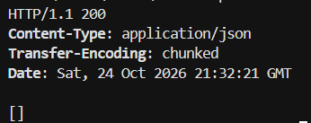
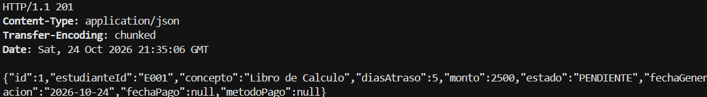
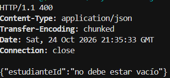
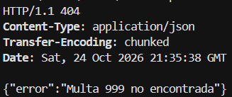
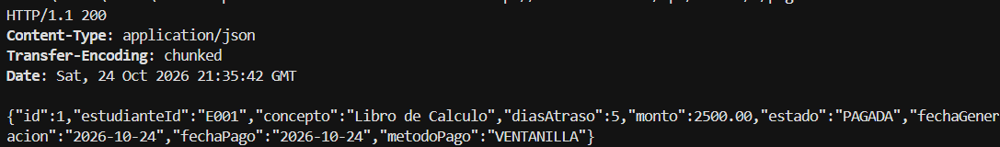
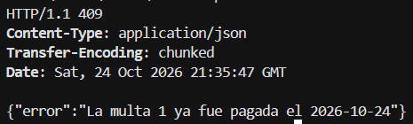

# Post-contenido — Unidad 7: Patrones Arquitectónicos I

## Descripción

Repositorio del post-contenido de la Unidad 7 de Patrones de Diseño de Software. Un único proyecto Spring Boot (`multas-biblioteca-api`) para la gestión de multas de biblioteca universitaria, con dos partes: una API REST en capas (Model, Repository, Service, Controller) sobre H2, y el pago en línea de multas con dos pasarelas intercambiables (PagosUDES y Wompi).

## Parte 1: Arquitectura en capas

MultaController (presentación) expone `/api/multas` y solo habla con MultaService, que concentra las reglas de negocio de aplicación (límite de multas pendientes y generación). MultaRepository (infraestructura) extiende JpaRepository y agrega la consulta agregada `countByEstudianteIdAndEstado`. El cálculo del monto vive en la propia entidad Multa (`Multa.calcularMonto`).

## Parte 2: Pago en línea con dos pasarelas

Se eligió la Opción C (puerto de dominio con adaptadores) solo para la porción de pago. `domain/port/PasarelaPagoPort` y `domain/ResultadoPago` son Java puro, sin Spring. `infrastructure/pago/PagosUdesAdapter` y `infrastructure/pago/WompiAdapter` traducen cada formato HTTP externo al mismo ResultadoPago y se seleccionan por `app.pagos.proveedor`, sin tocar MultaController ni los métodos previos de MultaService. El resto del proyecto (Multa, MultaRepository, MultaController) se mantiene en capas simples.

### Estructura de paquetes final

```
multas-biblioteca-api/src/main/java/com/example/multas/
├── controller/       ← Presentación (MultaController, GlobalExceptionHandler)
├── service/          ← Aplicación (MultaService, depende de PasarelaPagoPort)
├── model/            ← Dominio de capas (Multa, EstadoMulta, excepciones)
├── repository/       ← Infraestructura de persistencia (MultaRepository)
├── domain/           ← NUEVO: puerto y resultado, sin Spring
│   ├── port/PasarelaPagoPort.java
│   ├── ResultadoPago.java
│   └── PagoRechazadoException.java
├── infrastructure/   ← NUEVO: adaptadores, conocen Spring y HTTP
│   ├── pago/PagosUdesAdapter.java
│   ├── pago/WompiAdapter.java
│   └── config/RestTemplateConfig.java
└── MultasApplication.java
```

## Cómo ejecutar

```powershell
cd multas-biblioteca-api
mvn clean package
mvn spring-boot:run
```

Para probar el pago en línea sin pasarelas reales: `java herramientas\SimuladorPasarelas.java` (aprueba) o `java herramientas\SimuladorPasarelas.java rechazar`. Para cambiar de pasarela, editar `app.pagos.proveedor` (`pagosudes` o `wompi`) en `application.properties` y reiniciar.

## Evidencias

| Prueba | Captura |
|---|---|
| GET /api/multas (lista vacía, 200) |  |
| POST /api/multas (201, monto calculado) |  |
| POST sin estudianteId (400) |  |
| GET /api/multas/999 (404) |  |
| PATCH pagar (200) y repetido (409) |  |
| Cuarta multa pendiente (409) |  |
| Pago en línea con PagosUDES (200) |  |
| Pago en línea repetido (409) |  |
| Pago rechazado por la pasarela (402) |  |
| Pago en línea con Wompi (200) |  |

## Herramientas utilizadas

- Java 21, Spring Boot 3.2, Spring Data JPA, H2, RestTemplate
- Apache Maven, curl, VS Code, Git, GitHub

## Decisiones de diseño

### Punto de decisión 1 — Cálculo del monto: ¿entidad o Service?

El cálculo del monto (días de atraso por un valor fijo, con tope) vive en `Multa.calcularMonto` porque solo depende del número de días recibido como parámetro: no necesita el Repository ni ningún otro colaborador. Es una regla de dominio que describe cómo se comporta una Multa, no cómo se orquesta un caso de uso. El criterio usado fue: si la regla no necesita ningún colaborador externo, es candidata a vivir en el objeto de dominio; si necesita un Repository u otro Service, vive en el Service. Dejarla como método privado de MultaService habría convertido a Multa en un contenedor de datos sin comportamiento propio (modelo anémico) y habría obligado a cualquier otro punto que necesitara recalcular un monto a duplicar la fórmula o a pasar por el Service para algo que no requiere ninguna dependencia.

### Punto de decisión 2 — Conteo de multas pendientes: ¿consulta o filtrado en memoria?

Contar las multas pendientes sí requiere datos que solo la base de datos conoce. Se resolvió con `MultaRepository.countByEstudianteIdAndEstado`, que Spring Data traduce a un COUNT en SQL, en lugar de traer con `findByEstudianteId` todas las multas del estudiante y filtrarlas con streams. La decisión de negocio ("¿se le permite generar una multa más?") la toma exclusivamente MultaService, pero el dato que necesita se resuelve donde es eficiente: en el motor de base de datos. Si la tabla creciera a miles de multas por estudiante, la alternativa en memoria cargaría todas esas filas en cada creación y degradaría el tiempo de respuesta proporcionalmente al historial, mientras que la consulta agregada devuelve un único número.

### Punto de decisión 3 — Selección del adaptador activo

Se eligió `@ConditionalOnProperty` sobre `app.pagos.proveedor`: solo uno de los dos adaptadores existe como bean según la configuración, por lo que MultaService pide un único PasarelaPagoPort por constructor, sin `@Qualifier` ni lógica condicional propia. La alternativa, inyectar un `Map<String, PasarelaPagoPort>` y elegir la clave en tiempo de ejecución, da más flexibilidad (cambiar de proveedor sin reiniciar), pero el requisito real es una pasarela fija por sede durante el piloto, y esa opción habría obligado a MultaService a conocer las claves de configuración de cada proveedor. Cambiar de pasarela requiere solo editar la propiedad y reiniciar, sin recompilar el Controller ni el Service.

### Punto de decisión 4 — Diseño del puerto y el tipo de resultado

PagosUdesAdapter y WompiAdapter reciben y devuelven formatos distintos (idTransaccion/estadoTransaccion en un caso, reference/status con montos en centavos en el otro), pero ambos traducen su respuesta al mismo ResultadoPago, que usa campos neutrales como `referenciaExterna`. Si el puerto devolviera el DTO propio de cada pasarela, o tuviera un método por proveedor, MultaService tendría que conocer y distinguir ambos formatos, y agregar una tercera pasarela obligaría a modificar el Service además de crear un adaptador. Si ResultadoPago tuviera un campo llamado `idTransaccion`, WompiAdapter tendría que inventar un valor o dejarlo con un nombre que no describe lo que Wompi realmente devuelve (`reference`), señal de que el tipo de dominio no sería neutral respecto a los proveedores concretos.

### Trade-off considerado — Parte 2

Se descartó la Opción B (interfaz Strategy dentro de `service/`). A su favor tiene dos argumentos reales: es más simple, porque evita los paquetes `domain/` e `infrastructure/`, y resuelve la intercambiabilidad igual de bien con polimorfismo y `@ConditionalOnProperty`. En contra tiene que las implementaciones, con sus DTOs y su formato HTTP, quedarían dentro del paquete de la capa de aplicación, mezclando detalles de integración con la lógica de negocio. La opción elegida tuvo un costo concreto: dos paquetes nuevos, seis archivos más (puerto, resultado, excepción, dos adaptadores y la configuración de RestTemplate), el código de traducción duplicado en cada adaptador y una curva de aprendizaje mayor para quien mantenga el proyecto. A cambio, MultaService no conoce HTTP ni a ninguna pasarela, y agregar o quitar un proveedor implica solo un adaptador y un valor de configuración. Si el piloto terminara y solo quedara una pasarela, el equipo consideraría revertir: con una única implementación, el puerto pierde buena parte de su valor y la estructura podría simplificarse a una clase concreta en `service/`.

## Conclusiones

Este post-contenido mostró que la arquitectura en capas sostiene bien un sistema simple siempre que cada regla de negocio se ubique con un criterio explícito: en la entidad si no necesita colaboradores, en el Service si necesita datos de la base. El requisito de dos pasarelas con contratos HTTP distintos fue el punto de quiebre que justificó introducir un puerto de dominio solo en esa porción del sistema, sin migrar todo el proyecto a hexagonal. Lo más difícil de decidir fue distinguir entre una variación simple (Strategy en `service/`) y el puerto con adaptadores, porque ambas resuelven la intercambiabilidad y la diferencia está en dónde queda el conocimiento del formato HTTP externo y en cuánto cuesta cada opción si el número de proveedores cambia.